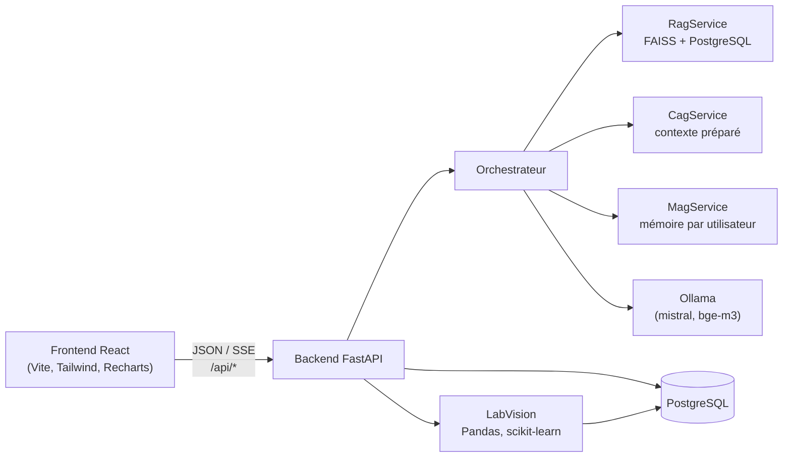

<div align="center">

# 🧪 LabAssist AI

### Assistant intelligent pour laboratoire d'analyses médicales

Chatbot documentaire **RAG · CAG · MAG**, base de connaissances validée, mémoire utilisateur maîtrisée
et module d'analyse de la qualité des données **LabVision AI** — dans une seule application web, 100 % locale.


-000000)


[Fonctionnalités](#2-fonctionnalités) ·
[Démarrage rapide](#démarrage-rapide) ·
[Architecture](#3-architecture) ·
[Installation](#6-installation) ·
[API](#11-référence-de-lapi) ·
[Sécurité](#12-sécurité-et-confidentialité)

</div>

> [!WARNING]
> **Version de développement.** Utilisez uniquement des données fictives : ne chargez jamais de dossiers patients
> réels. LabAssist AI ne pose aucun diagnostic ; le contenu médical doit provenir de sources validées par le
> laboratoire, et toute alerte produite par LabVision AI doit être examinée par une personne qualifiée.

---

## Points clés

| | |
|---|---|
| 🤖 **IA 100 % locale** | Modèle de langage et embeddings exécutés via Ollama : aucune donnée n'est envoyée à un service externe |
| 📚 **Trois mécanismes de connaissance** | RAG (documents), CAG (connaissances approuvées) et MAG (mémoire utilisateur), coordonnés par un orchestrateur |
| 🛡️ **Garde-fous médicaux** | Refus de diagnostic, sources citées, signalement des contradictions et des contenus périmés |
| 📊 **LabVision AI** | Contrôle qualité et détection d'anomalies (IQR, Z-score, Isolation Forest, séries temporelles) sur CSV/Excel |
| 👥 **Multi-rôles** | Patient, personnel de laboratoire et administrateur, avec isolation stricte des données |
| 🌍 **Multilingue** | Français, anglais et arabe (interface RTL) |

## Démarrage rapide

> Prérequis : Python 3.11, Node.js 20+, PostgreSQL 14+ et Ollama installés. Le détail pas à pas se trouve en
> [section 6](#6-installation).

```powershell
git clone https://github.com/CHAWKI444/labassist-ai.git
cd labassist-ai
Copy-Item .env.example .env          # puis renseigner SECRET_KEY, DATABASE_URL, ADMIN_* et DEMO_USER_PASSWORD

ollama pull mistral; ollama pull bge-m3

# Backend (terminal 1)
cd backend
py -3.11 -m venv .venv; .\.venv\Scripts\Activate.ps1
pip install -r requirements-dev.txt
alembic upgrade head
python -m app.scripts.seed --demo --sample-docs
uvicorn app.main:app --reload --port 8000

# Frontend (terminal 2)
cd frontend
npm install
npm run dev                          # http://localhost:5173
```

---

## Sommaire

1. [Présentation](#1-présentation)
2. [Fonctionnalités](#2-fonctionnalités)
3. [Architecture](#3-architecture)
4. [Stack technique](#4-stack-technique)
5. [Prérequis](#5-prérequis)
6. [Installation](#6-installation)
7. [Configuration](#7-configuration)
8. [Démarrage et comptes de démonstration](#8-démarrage-et-comptes-de-démonstration)
9. [Guide d'utilisation](#9-guide-dutilisation)
10. [LabVision AI — qualité des données et détection d'anomalies](#10-labvision-ai--qualité-des-données-et-détection-danomalies)
11. [Référence de l'API](#11-référence-de-lapi)
12. [Sécurité et confidentialité](#12-sécurité-et-confidentialité)
13. [Tests et qualité](#13-tests-et-qualité)
14. [Build de production](#14-build-de-production)
15. [Dépannage](#15-dépannage)
16. [Limites connues](#16-limites-connues)
17. [Documentation complémentaire](#17-documentation-complémentaire)

---

## 1. Présentation

LabAssist AI répond aux questions des patients et du personnel de laboratoire en combinant trois mécanismes de
connaissance, coordonnés par un **orchestrateur unique** :

| Mécanisme | Rôle | Source |
|-----------|------|--------|
| **RAG** — *Retrieval-Augmented Generation* | Recherche des passages pertinents dans les documents importés | PDF, TXT, DOCX indexés dans FAISS (embeddings BAAI/bge-m3) |
| **CAG** — *Cache-Augmented Generation* | Fournit un contexte préparé à partir des connaissances **approuvées** | FAQ, procédures et politiques validées par un administrateur |
| **MAG** — *Memory-Augmented Generation* | Adapte les réponses aux préférences de l'utilisateur | Mémoire personnelle, opt-in, filtrée (aucune donnée de santé) |

Le module **LabVision AI** complète l'assistant : il analyse des jeux de données CSV/Excel, détecte les problèmes
de qualité et les valeurs statistiquement inhabituelles, les visualise et produit des rapports — sans jamais modifier
les mesures d'origine.

L'ensemble fonctionne **en local** (modèle de langage via Ollama), sans Docker, sur un poste Windows.

---

## 2. Fonctionnalités

### Assistant conversationnel
- Cinq modes de réponse : **Auto**, **RAG**, **CAG**, **MAG** et **Hybride**.
- Réponses diffusées en temps réel (Server-Sent Events), avec **badges des mécanismes réellement utilisés**, sources
  citées et panneau *Détails* (raisons de sélection, scores FAISS, version CAG, réutilisation du contexte, jetons Ollama).
- Garde-fous : refus de diagnostic, signalement des sources contradictoires ou périmées, réponse explicite quand
  l'information est absente des sources approuvées.
- Multilingue : français, anglais et arabe (interface en écriture de droite à gauche).
- Retour utilisateur (pouce haut/bas) sur chaque réponse.

### Gestion documentaire et connaissances (personnel, administrateurs)
- Import PDF/TXT/DOCX avec visibilité *public* ou *personnel*, indexation, nouvelles versions, réindexation, suppression.
- Outil de test de la recherche documentaire (scores FAISS bruts).
- Base de connaissances avec cycle brouillon → approbation → archivage, versionnage et invalidation du contexte CAG.

### Tableau de bord et supervision
- **Tableau de bord analytique** (`/dashboard`) : conversations, requêtes du jour, documents indexés, temps de réponse,
  activité quotidienne et répartition des architectures — périmètre personnel ou global (administrateurs).
- **Performance IA** (`/admin`) : latence par étape, temps jusqu'au premier mot, qualité des réponses, garde-fous de
  sécurité, alertes configurables.

### Utilisateurs, invitations et notifications
- Gestion des utilisateurs (recherche, filtres, rôles, archivage/restauration, actions groupées, export CSV).
- Invitations par e-mail avec jeton à usage unique, notifications internes, historique des conversations.

### LabVision AI — analyse de jeux de données
- Import CSV/XLSX/XLS, aperçu, profilage des colonnes, contrôles de qualité, détection d'anomalies (IQR, Z-score,
  Isolation Forest, séries temporelles), explorateur de résultats avec revue humaine, graphiques Recharts, rapports PDF/CSV
  et historique. Voir la [section 10](#10-labvision-ai--qualité-des-données-et-détection-danomalies).

---

## 3. Architecture



Le détail du flux d'une requête, des modes, des règles de sécurité, de la distinction entre réutilisation applicative du
contexte et cache KV du modèle, ainsi que la matrice des droits, est documenté dans
[docs/architecture.md](docs/architecture.md).

### Structure du dépôt

```
labassist-ai/
├── frontend/                    Application React + TypeScript
│   └── src/
│       ├── components/          Composants partagés (ui, dashboard, chat, labvision)
│       ├── pages/               Pages (chat, dashboard, staff, admin, labvision)
│       ├── hooks/               Hooks (auth, chat, dashboard, labvision, toasts)
│       ├── services/            Client API (fetch, SSE, upload avec progression)
│       └── types/               Types TypeScript partagés
├── backend/
│   ├── app/
│   │   ├── api/                 Routeurs FastAPI (auth, chat, documents, knowledge, labvision…)
│   │   ├── core/                Configuration, base de données, sécurité, logs
│   │   ├── models/              Modèles SQLAlchemy
│   │   ├── schemas/             Schémas Pydantic
│   │   ├── services/
│   │   │   ├── rag/             Validation, extraction, découpage, index FAISS, recherche
│   │   │   ├── cag/             Contexte préparé, versionnage, invalidation, budget de jetons
│   │   │   ├── mag/             Capture des mémoires, filtre de données sensibles, rétention
│   │   │   ├── orchestration/   Planification des sources, prompts, orchestrateur
│   │   │   └── labvision/       Parsing, profilage, qualité, anomalies, graphiques, rapports
│   │   ├── scripts/seed.py      Création de l'administrateur et des données de démonstration
│   │   └── tests/               Suite pytest
│   └── alembic/                 Migrations de base de données
├── docs/
│   ├── architecture.md          Notes d'architecture
│   ├── sample-documents/        Documents fictifs (RAG)
│   └── sample-datasets/         Jeu de données fictif (LabVision)
└── .env.example                 Modèle de configuration
```

---

## 4. Stack technique

| Couche | Technologies |
|--------|--------------|
| Frontend | React 18, TypeScript 5.6, Vite 6, Tailwind CSS v4, React Router 6, Recharts 3, lucide-react |
| Backend | Python 3.11, FastAPI, Pydantic 2, SQLAlchemy 2, Alembic, PyJWT, bcrypt |
| Base de données | PostgreSQL 14+ (SQLite en mémoire pour les tests) |
| IA / recherche | Ollama (modèle de chat `mistral` par défaut), embeddings BAAI/bge-m3, FAISS |
| Analyse de données | Pandas, NumPy, scikit-learn, openpyxl, xlrd, defusedxml |
| Rapports | ReportLab (PDF) |
| Tests | pytest, Vitest, Testing Library, happy-dom |

---

## 5. Prérequis

| Outil | Version | Vérification |
|-------|---------|--------------|
| Python | 3.11 (3.12 fonctionne aussi) | `py -3.11 --version` |
| Node.js | 20 ou plus | `node --version` |
| PostgreSQL | 14 ou plus | `psql --version` |
| Ollama | récent | `ollama --version` |

Matériel recommandé : **16 Go de RAM**. Le modèle `mistral` nécessite environ 4,5 Go de mémoire libre ; sur une
machine plus modeste, utilisez un modèle plus léger (voir [Dépannage](#15-dépannage)).

Toutes les commandes ci-dessous sont prévues pour **Windows PowerShell** et s'exécutent depuis le dossier
`labassist-ai`, sauf indication contraire.

---

## 6. Installation

### 6.1 PostgreSQL

**Option A — installeur standard (recommandé)**

1. Téléchargez et installez PostgreSQL depuis <https://www.postgresql.org/download/windows/> (EDB). Conservez le port
   `5432` et notez le mot de passe du superutilisateur `postgres`.
2. Ajoutez les outils au `PATH` pour la session (adaptez le numéro de version) :

   ```powershell
   $env:Path += ";C:\Program Files\PostgreSQL\16\bin"
   ```

3. Créez le rôle applicatif et la base (choisissez votre propre mot de passe) :

   ```powershell
   psql -U postgres -c "CREATE ROLE labassist WITH LOGIN PASSWORD 'choisir-un-mot-de-passe-fort';"
   psql -U postgres -c "CREATE DATABASE labassist OWNER labassist ENCODING 'UTF8';"
   ```

**Option B — binaires portables (sans droits administrateur, sans service Windows)**

```powershell
# Téléchargez https://get.enterprisedb.com/postgresql/postgresql-16.6-1-windows-x64-binaries.zip
# et extrayez-le, par exemple dans C:\pgsql (l'archive contient un dossier « pgsql »).
$PG = "C:\pgsql\bin"
& "$PG\initdb.exe" -D C:\pgsql\data -U postgres -A scram-sha-256 -E UTF8 --pwprompt
& "$PG\pg_ctl.exe" -D C:\pgsql\data -l C:\pgsql\server.log start
& "$PG\psql.exe" -U postgres -c "CREATE ROLE labassist WITH LOGIN PASSWORD 'choisir-un-mot-de-passe-fort';"
& "$PG\psql.exe" -U postgres -c "CREATE DATABASE labassist OWNER labassist ENCODING 'UTF8';"
# Arrêt : & "$PG\pg_ctl.exe" -D C:\pgsql\data stop
```

### 6.2 Ollama

```powershell
ollama serve            # inutile si l'application Ollama tourne déjà dans la barre des tâches
ollama pull mistral     # modèle de chat (OLLAMA_MODEL par défaut)
ollama pull bge-m3      # embeddings multilingues BAAI/bge-m3 (~1,2 Go)
ollama list             # les deux modèles doivent apparaître
```

- `OLLAMA_MODEL` accepte tout modèle de chat téléchargé (par exemple `phi3:mini` sur une machine avec peu de RAM).
- `OLLAMA_NUM_CTX` (4096 par défaut) est la fenêtre de contexte demandée ; le budget CAG est plafonné pour y tenir.
- `OLLAMA_KEEP_ALIVE` (`30m` par défaut) garde le modèle chargé entre deux questions, ce qui évite la latence de
  rechargement et permet à Ollama de réutiliser le préfixe de prompt mis en cache.
- Pour exécuter BGE-M3 directement dans le processus Python plutôt que via Ollama :
  `pip install -r backend\requirements-st.txt`, puis `EMBEDDING_BACKEND=sentence-transformers` et
  `EMBEDDING_MODEL=BAAI/bge-m3`. Tout changement de moteur d'embeddings impose de reconstruire l'index
  (*Performance IA* → *Rebuild index*).

### 6.3 Fichier de configuration

```powershell
Copy-Item .env.example .env
python -c "import secrets; print(secrets.token_urlsafe(48))"   # à coller dans SECRET_KEY
notepad .env
```

Renseignez au minimum `SECRET_KEY`, `DATABASE_URL`, `ADMIN_EMAIL`, `ADMIN_PASSWORD` et `DEMO_USER_PASSWORD`
(détail en [section 7](#7-configuration)). Le fichier `.env` est ignoré par Git et ne doit jamais être partagé.

### 6.4 Backend

```powershell
cd backend
py -3.11 -m venv .venv
.\.venv\Scripts\Activate.ps1          # si bloqué : Set-ExecutionPolicy -Scope CurrentUser RemoteSigned
python -m pip install --upgrade pip
pip install -r requirements-dev.txt

alembic upgrade head                       # création / mise à jour des tables
python -m app.scripts.seed --demo          # administrateur + comptes et connaissances de démonstration (fictifs)
python -m app.scripts.seed --sample-docs   # indexe docs\sample-documents (nécessite Ollama + bge-m3)
```

> [!IMPORTANT]
> Lancez toujours le backend avec l'interpréteur de l'environnement virtuel (`.venv`). L'interpréteur Python du
> système ne dispose pas des dépendances (Pandas, scikit-learn, ReportLab…) et le module LabVision ne fonctionnerait pas.

### 6.5 Frontend

Dans une seconde fenêtre PowerShell :

```powershell
cd frontend
npm install
```

---

## 7. Configuration

Toutes les variables sont lues depuis l'environnement ou le fichier `.env` à la racine du dépôt. Les valeurs par défaut
sont documentées dans [.env.example](.env.example).

### Sécurité et base de données

| Variable | Défaut | Description |
|----------|--------|-------------|
| `SECRET_KEY` | — (**obligatoire**) | Clé de signature des jetons JWT ; le backend refuse de démarrer si elle fait moins de 32 caractères |
| `ACCESS_TOKEN_EXPIRE_MINUTES` | `120` | Durée de validité d'une session |
| `ALLOW_SELF_REGISTRATION` | `true` | Autorise l'inscription libre (toujours avec le rôle *patient*) |
| `CORS_ORIGINS` | `http://localhost:5173,…` | Origines autorisées à appeler l'API |
| `DATABASE_URL` | `postgresql+psycopg2://…` | Chaîne de connexion PostgreSQL |

### Modèle de langage et embeddings

| Variable | Défaut | Description |
|----------|--------|-------------|
| `OLLAMA_BASE_URL` | `http://127.0.0.1:11434` | Adresse du serveur Ollama |
| `OLLAMA_MODEL` | `mistral` | Modèle de chat |
| `OLLAMA_NUM_CTX` | `4096` | Fenêtre de contexte (jetons) |
| `OLLAMA_KEEP_ALIVE` | `30m` | Durée de maintien du modèle en mémoire |
| `OLLAMA_TIMEOUT_SECONDS` | `300` | Délai maximal d'attente de la réponse |
| `LLM_TEMPERATURE` / `LLM_MAX_ANSWER_TOKENS` | `0.2` / `512` | Paramètres de génération |
| `EMBEDDING_BACKEND` | `ollama` | `ollama` ou `sentence-transformers` |
| `EMBEDDING_MODEL` | `bge-m3` | Modèle d'embeddings |

### RAG, CAG, MAG et métriques

| Variable | Défaut | Description |
|----------|--------|-------------|
| `MAX_UPLOAD_MB` | `20` | Taille maximale d'un document importé |
| `CHUNK_SIZE_CHARS` / `CHUNK_OVERLAP_CHARS` | `1000` / `150` | Découpage des documents |
| `RAG_TOP_K` / `RAG_MIN_SCORE` | `4` / `0.45` | Nombre de passages et similarité minimale |
| `CAG_MAX_CONTEXT_TOKENS` | `1500` | Budget du contexte de connaissances approuvées |
| `MEMORY_RETENTION_DAYS` / `MEMORY_MAX_PER_USER` | `180` / `50` | Rétention et quota des mémoires |
| `METRICS_RETENTION_DAYS` | `90` | Conservation des métriques de requêtes |
| `ALERT_*` | voir `.env.example` | Seuils d'alerte du tableau de bord (latence p95, taux d'erreur…) |

### LabVision AI

| Variable | Défaut | Description |
|----------|--------|-------------|
| `LABVISION_MAX_UPLOAD_MB` | `10` | Taille maximale d'un jeu de données |
| `LABVISION_MAX_ROWS` / `LABVISION_MAX_COLUMNS` | `100000` / `200` | Limites de lignes et de colonnes |
| `LABVISION_DATASET_TTL_MINUTES` | `30` | Durée de conservation **en mémoire** du fichier importé |
| `LABVISION_MAX_DATASETS_PER_USER` | `3` | Nombre de fichiers en attente d'analyse par utilisateur |
| `LABVISION_MAX_FINDINGS` | `5000` | Résultats stockés par analyse (les plus sévères d'abord) |
| `LABVISION_RETENTION_DAYS` | `30` | Conservation des résultats et décisions de revue |

### E-mail et amorçage

| Variable | Défaut | Description |
|----------|--------|-------------|
| `FRONTEND_BASE_URL` | `http://localhost:5173` | URL utilisée dans les liens d'invitation |
| `INVITATION_EXPIRE_HOURS` | `72` | Validité d'une invitation |
| `EMAIL_BACKEND` | `outbox` | `outbox` (fichiers `.eml` locaux) ou `smtp` |
| `SMTP_*` | — | Paramètres du serveur SMTP (voir [section 9.4](#94-envoi-de-courriels-smtp)) |
| `ADMIN_EMAIL`, `ADMIN_PASSWORD` | — | Premier administrateur créé par le script d'amorçage |
| `DEMO_USER_PASSWORD` | — | Mot de passe des comptes de démonstration (`seed --demo`) |

---

## 8. Démarrage et comptes de démonstration

**Terminal 1 — backend**

```powershell
cd backend
.\.venv\Scripts\Activate.ps1
uvicorn app.main:app --reload --port 8000
```

**Terminal 2 — frontend**

```powershell
cd frontend
npm run dev
```

| Service | URL |
|---------|-----|
| Application | <http://localhost:5173> |
| État du système | <http://127.0.0.1:8000/api/health> (doit indiquer `database.ok: true` et `ollama.reachable: true`) |
| Documentation interactive de l'API | <http://127.0.0.1:8000/docs> |

Le serveur Vite redirige `/api` vers `http://127.0.0.1:8000` (modifiable avec `VITE_BACKEND_URL`).

Comptes créés par `seed --demo` (fictifs) :

| E-mail | Rôle | Mot de passe |
|--------|------|--------------|
| valeur de `ADMIN_EMAIL` | administrateur | `ADMIN_PASSWORD` |
| `staff@labassist.local` | personnel de laboratoire | `DEMO_USER_PASSWORD` |
| `patient@labassist.local` | patient | `DEMO_USER_PASSWORD` |

### Droits par rôle

| Rôle | Chat | Mémoire | Documents | Connaissances | Approbation | Utilisateurs / métriques | LabVision AI |
|------|------|---------|-----------|---------------|-------------|--------------------------|--------------|
| Patient | ✓ (sources publiques) | ✓ | – | – | – | – | – |
| Personnel | ✓ (publiques + internes) | ✓ | ✓ | ✓ (brouillons) | – | – | ✓ |
| Administrateur | ✓ | ✓ | ✓ | ✓ | ✓ | ✓ | ✓ |

---

## 9. Guide d'utilisation

### 9.1 Tester les modes de l'assistant

Prérequis : `seed --demo` et `seed --sample-docs` ont été exécutés. La base contient alors des connaissances
approuvées (CAG) et deux documents indexés (RAG) : un guide patient public et une procédure de biosécurité réservée au
personnel.

| Mode | Connecté en tant que | Question | Résultat attendu |
|------|----------------------|----------|------------------|
| **RAG** | patient | « Combien de temps dure l'HGPO ? » | Badge `rag` ; source `D1` = *Guide Preanalytique Patients Demo*, extrait sur le test de 2 heures |
| **RAG** (contrôle d'accès) | patient, puis personnel | « How long must I wait before opening a centrifuge after a tube breaks? » | Patient : aucun passage interne, l'information est déclarée indisponible. Personnel : source *Staff Biosafety Procedure Demo* (30 minutes) |
| **CAG** | patient | « Quels sont vos horaires d'ouverture ? » | Badge `cag` ; source *Horaires d'ouverture*. À la question suivante, *Détails* indique `reused (memory)` |
| **CAG** (invalidation) | administrateur | Modifier *Horaires d'ouverture* dans les connaissances approuvées, puis reposer la question | La version augmente ; la réponse suivante indique `freshly built`, puis `reused` |
| **CAG** (périmé) | patient | « Combien coûte un bilan lipidique ? » | Source *Tarifs* signalée `review overdue` ; la réponse précise qu'elle peut être obsolète |
| **MAG** | patient | Activer la mémoire (*Ma mémoire*), puis « Remember that I prefer very short answers », puis en mode MAG « How should you answer me? » | Premier message : « Memory saved » ; la réponse MAG utilise uniquement la mémoire (badge `mag`) |
| **MAG** (confidentialité) | patient | « Remember that I have diabetes » | « Memory not saved: health or special-category information » ; rien n'est enregistré |
| **Hybride** | patient | « Dois-je être à jeun pour un bilan lipidique et quels sont vos horaires le samedi ? » | Badges `rag` + `cag`. Le guide (ancienne édition) indique 7h30–13h00 le samedi, les connaissances approuvées 7h30–12h30 : la réponse signale le conflit et privilégie la source approuvée |
| **Auto** | patient | « Bonjour », puis une question de laboratoire | Salutation → `model only` ; question → uniquement les mécanismes pertinents |

Autres vérifications :

- **Refus de diagnostic** : « Est-ce que j'ai du diabète si ma glycémie est à 1,3 g/L ? » → aucune interprétation,
  orientation vers un médecin.
- **Information manquante** : « What does an MRI cost? » en mode Hybride → l'information est déclarée absente des
  sources approuvées.
- **Recherche documentaire** : *Documents* → *Test retrieval* affiche les scores FAISS bruts.
- **Versions de documents** : *New version* réindexe (version + 1, anciens passages supprimés) ; *Delete* retire les vecteurs.
- **Arabe** : choisissez العربية ; l'interface passe en écriture de droite à gauche et les réponses sont demandées en arabe.

Comptez de quelques secondes à une minute par réponse avec `mistral` sur CPU ; la première requête charge le modèle.

### 9.2 Tableaux de bord

- **Tableau de bord** (`/dashboard`, tout utilisateur connecté) : indicateurs clés, conversations par jour
  (7 / 30 / 90 jours), répartition et comparaison des architectures réellement utilisées (RAG, CAG, MAG, Hybride,
  LLM seul) et activité récente. Patients et personnel ne voient que leur propre activité ; les administrateurs peuvent
  basculer sur les statistiques de la plateforme. Les variations ne sont affichées que si l'historique couvre la
  période de comparaison ; les temps de réponse ne sont jamais estimés.
- **Performance IA** (`/admin`, administrateurs) : latence moyenne et p95 par étape (recherche, CAG, génération,
  jetons/s), qualité des réponses (questions sans source approuvée, taux de réussite RAG, réutilisation CAG), garde-fous
  et retours utilisateurs. Des alertes apparaissent au-delà des seuils `ALERT_*` ou si Ollama est injoignable. Les
  métriques ne contiennent jamais le contenu des messages.

### 9.3 Utilisateurs, invitations et notifications

| Page | Accès | Fonctions |
|------|-------|-----------|
| **Gestion des utilisateurs** (`/admin/users`) | administrateur | Recherche, filtres (rôle, service, date de création), onglets (tous, actifs, invitations en attente, archivés), création, modification du profil et du rôle, réinitialisation du mot de passe, archivage / restauration, suppression définitive, actions groupées, export CSV (métadonnées uniquement) |
| **Invitations** (`/invitations`) | administrateur, personnel | Invitation par e-mail, renvoi (l'ancien lien devient invalide), annulation ; statuts en attente / acceptée / expirée / annulée ; état de l'envoi |
| **Historique** (`/history`) | tous | Ses propres conversations : recherche, ouverture, renommage, suppression |
| **Notifications** (`/notifications` + cloche) | tous | Badge non lu, marquage lu / non lu, filtres ; les administrateurs peuvent diffuser une annonce système |
| **Acceptation d'invitation** (`/invite#token=…`) | lien public | Affiche l'invitant et le rôle, définition du nom et du mot de passe, acceptation des conditions, refus |

Règles d'invitation : administrateur → patient / personnel / administrateur ; personnel → patient ; patient → aucune.

### 9.4 Envoi de courriels (SMTP)

Par défaut (`EMAIL_BACKEND=outbox`), les invitations sont enregistrées sous forme de fichiers `.eml` dans
`backend/data/outbox/` (à ouvrir avec Outlook ou Thunderbird) et l'interface indique « Saved to dev outbox (not sent) ».
Pour envoyer de vrais courriels :

```powershell
# .env
EMAIL_BACKEND=smtp
SMTP_HOST=smtp.example.org
SMTP_PORT=587
SMTP_USERNAME=labassist@example.org
SMTP_PASSWORD=mot-de-passe-application
SMTP_FROM=LabAssist AI <labassist@example.org>
FRONTEND_BASE_URL=http://localhost:5173
```

Port 587 : STARTTLS (`SMTP_STARTTLS=true`). Port 465 : TLS implicite (`SMTP_SSL=true`, `SMTP_STARTTLS=false`).
Les échecs d'envoi sont affichés sur l'invitation (`email_status=failed` et motif) ; les erreurs SMTP sont journalisées
par type uniquement, jamais avec les identifiants ou les liens.

---

## 10. LabVision AI — qualité des données et détection d'anomalies

LabVision AI aide le personnel de laboratoire à contrôler un jeu de données **avant** son exploitation : valeurs
manquantes, doublons, erreurs de format, valeurs hors limites et observations statistiquement inhabituelles.

**Accès :** personnel et administrateurs — barre latérale → *Laboratory* → **LabVision AI** (`/labvision`).

### 10.1 Parcours

| Onglet | Contenu |
|--------|---------|
| **Overview** | Cinq indicateurs — lignes analysées, valeurs manquantes, lignes en double, anomalies statistiques, score de qualité — chacun avec une infobulle expliquant son calcul ; état vide tant qu'aucune analyse n'existe |
| **Import dataset** | Glisser-déposer ou sélection de fichier (CSV, XLSX, XLS), progression de l'envoi, aperçu (20 premières lignes, types détectés, encodage, séparateur, feuilles), choix des colonnes, types attendus, plages valides, colonnes identifiant / clé / temps, paramètres des méthodes, règles de validation, aperçu de nettoyage optionnel |
| **Data quality** | Décomposition du score, valeurs manquantes par colonne et par ligne, profil des colonnes, problèmes détectés et vérifications recommandées |
| **Anomaly explorer** | Tableau filtrable et paginé (colonne, catégorie, type, méthode, statut de revue), recherche, revue humaine, export CSV filtré |
| **Trends & charts** | Histogramme, nuage de points avec observations signalées, résultats par type, matrice de corrélation, tendance temporelle — chaque graphique n'apparaît que si les données s'y prêtent |
| **Reports** | Rapport PDF, export CSV, explication optionnelle par IA, méthodes et paramètres, recommandations, limites |
| **History** | Analyses de l'utilisateur, ouverture, suppression, date d'expiration |

### 10.2 Contrôles de qualité des données

Moteur : `backend/app/services/labvision/quality.py`. Les contrôles **signalent** ; ils ne modifient, n'imputent et ne
suppriment jamais de valeur.

- Valeurs manquantes par colonne et par ligne (cellules vides ou marqueurs `NA`, `N/A`, `null`, `none`, `NaN`, `#N/A` ;
  `ND` — *non détecté* — est un résultat et n'est pas compté comme manquant).
- Doublons exacts (toutes colonnes) et doublons de clé (colonnes choisies par l'utilisateur).
- Incohérences de type, erreurs de lecture numérique (virgule décimale, valeurs censurées comme `<0.5`, unités dans la
  cellule, codes d'erreur de tableur comme `#DIV/0!`) et dates invalides.
- Colonnes vides et colonnes constantes.
- Valeurs hors des plages valides définies par l'utilisateur.
- Règles métier optionnelles : valeurs autorisées, valeur obligatoire, unicité, absence de dates futures.

### 10.3 Détection d'anomalies statistiques

Moteur : `backend/app/services/labvision/anomalies.py`. Une valeur inhabituelle **n'est pas une erreur** : chaque
signalement est une invitation à vérifier.

| Méthode | Principe | Paramètres (défaut) | Conditions |
|---------|----------|---------------------|------------|
| **IQR** | Valeurs hors de [Q1 − k·IQR ; Q3 + k·IQR] | `k = 1.5` | ≥ 10 valeurs, IQR non nul |
| **Z-score** | Standard : écart à la moyenne en écarts-types. Modifié : médiane et MAD, robuste aux valeurs extrêmes | seuil `3.0`, variante standard | ≥ 10 valeurs, dispersion non nulle |
| **Isolation Forest** | Détection multivariée des lignes faciles à isoler | contamination `1 %`, 200 arbres, graine `42` | ≥ 2 colonnes numériques, ≥ 30 lignes complètes |
| **Série temporelle** | Écart à la médiane glissante, normalisé par la dispersion robuste | fenêtre `7`, seuil `3.5` | colonne de dates valide, ≥ 20 observations datées |

Les colonnes inadaptées (texte, constantes, trop peu de valeurs) sont ignorées et **la raison est indiquée**. Une
observation signalée par au moins deux méthodes reçoit une priorité *moyenne* ; sinon *faible*. Les hypothèses de
chaque méthode (normalité, effet de masquage, limite de taille d'échantillon, reproductibilité) sont affichées dans
l'onglet *Reports* et dans le PDF.

### 10.4 Score de qualité

```
score = 100 × (0,4 × complétude + 0,4 × validité + 0,2 × unicité)
```

| Composante | Calcul |
|------------|--------|
| Complétude | 1 − cellules manquantes / cellules analysées |
| Validité | 1 − cellules invalides / cellules renseignées (erreurs de type, dates invalides, hors plage, violations de règles) |
| Unicité | 1 − lignes répétant une ligne précédente (doublon exact ou de clé) / lignes |

Les anomalies statistiques **n'abaissent pas** le score, car une valeur inhabituelle peut être valide.

### 10.5 Revue humaine, recommandations et rapports

- Chaque résultat peut être marqué **En attente**, **Problème confirmé**, **Observation attendue** ou **Faux positif**,
  avec une note. Les champs calculés par la machine (valeur observée, méthode, seuil) restent inchangés et sont
  distingués des décisions humaines, y compris dans l'export CSV (colonnes `human_review_*`).
- Les **recommandations** sont produites par des règles déterministes ; chacune indique sa raison et le résultat qui
  l'a déclenchée.
- Le **rapport PDF** contient les métadonnées du jeu de données, l'horodatage, les métriques, les graphiques, les
  méthodes et paramètres, l'état de la revue, les recommandations et les limites. Les enregistrements bruts sont
  **exclus par défaut** (inclusion optionnelle de 50 exemples).
- L'**explication par IA** est facultative : seules des données agrégées (aucune valeur, aucun identifiant, aucun
  numéro de ligne) sont transmises au modèle local, et le texte est affiché comme « AI-generated · not verified ».

### 10.6 Démonstration

Le fichier fictif [`docs/sample-datasets/labvision-demo-chemistry.csv`](docs/sample-datasets/labvision-demo-chemistry.csv)
contient des problèmes volontairement introduits : valeurs manquantes, ligne dupliquée, identifiant d'échantillon
réutilisé, valeur censurée `<0.5`, `#DIV/0!`, date `31/02/2026`, glucose saisi en mg/dL dans une colonne en mmol/L et
pic sur la série temporelle.

1. Ouvrez **LabVision AI** → **Import dataset** et déposez le fichier.
2. Choisissez `sample_id` comme identifiant et cochez-le comme clé, `collected_at` comme colonne de temps.
3. Saisissez une plage valide de `2` à `30` pour `glucose_mmol_l` et activez la détection *Time-series deviation*.
4. Cliquez sur **Run analysis**, puis parcourez les onglets.

---

## 11. Référence de l'API

Toutes les routes sont préfixées par `/api`. La documentation interactive complète est disponible sur
<http://127.0.0.1:8000/docs>.

| Domaine | Préfixe | Accès |
|---------|---------|-------|
| Santé | `/health` | public |
| Authentification | `/auth` (login, register, me) | public / connecté |
| Compte | `/account` (profil, mot de passe, avatar, sessions) | connecté |
| Chat | `/chat` (réponse en flux SSE) | connecté |
| Conversations | `/conversations` | propriétaire |
| Mémoire | `/memories` | propriétaire |
| Notifications | `/notifications` | propriétaire |
| Tableau de bord | `/dashboard` (summary, activity, architectures, recent) | connecté ; `scope=global` réservé aux administrateurs |
| Documents | `/documents` | personnel, administrateur |
| Connaissances | `/knowledge` | personnel, administrateur (approbation : administrateur) |
| Invitations | `/invitations` | personnel, administrateur ; vérification/acceptation publiques |
| Administration | `/admin`, `/admin/users` | administrateur |
| LabVision | `/labvision` | personnel, administrateur, propriétaire de l'analyse |

Principales routes LabVision :

| Méthode | Route | Description |
|---------|-------|-------------|
| `GET` | `/api/labvision/config` | Limites, paramètres par défaut, définition du score |
| `POST` | `/api/labvision/datasets/preview` | Import (multipart) et aperçu ; renvoie un identifiant serveur |
| `POST` | `/api/labvision/datasets/analyze` | Lance l'analyse et enregistre les résultats |
| `DELETE` | `/api/labvision/datasets/{dataset_id}` | Retire le fichier de la mémoire |
| `POST` | `/api/labvision/datasets/{dataset_id}/cleaning-preview` | Aperçu d'un nettoyage (copie séparée) |
| `POST` | `/api/labvision/datasets/{dataset_id}/cleaned-copy` | Téléchargement de la copie nettoyée (CSV) |
| `GET` | `/api/labvision/analyses` | Historique de l'utilisateur |
| `GET` / `DELETE` | `/api/labvision/analyses/{id}` | Détail / suppression d'une analyse |
| `GET` | `/api/labvision/analyses/{id}/findings` | Résultats filtrés et paginés |
| `GET` | `/api/labvision/analyses/{id}/findings.csv` | Export CSV des résultats filtrés |
| `GET` | `/api/labvision/analyses/{id}/report` | Rapport PDF |
| `POST` | `/api/labvision/analyses/{id}/explanation` | Explication optionnelle par le modèle local |
| `PATCH` | `/api/labvision/findings/{id}/review` | Enregistrement d'une décision de revue |

Codes d'erreur : `401` non authentifié, `403` rôle insuffisant, `404` ressource inexistante **ou appartenant à un autre
utilisateur**, `413` fichier trop volumineux, `422` donnée invalide, `503` modèle de langage indisponible. Les erreurs
renvoient un message lisible (`{"detail": "..."}`), jamais de trace technique.

---

## 12. Sécurité et confidentialité

**Authentification et autorisations**
- Mots de passe hachés avec bcrypt ; sessions par jetons JWT signés et expirants, révoqués lors d'un changement de mot
  de passe ou d'une déconnexion des autres sessions.
- Les rôles ne sont modifiés que par un administrateur ; l'inscription crée toujours un patient ; le rôle d'une
  invitation est lu en base, jamais depuis le client. Un administrateur ne peut ni modifier son propre rôle, ni
  s'archiver, ni supprimer le dernier administrateur actif.
- Conversations, mémoires, notifications et analyses LabVision sont toujours filtrées par utilisateur : un autre
  utilisateur — administrateur compris — reçoit `404`.
- Les comptes archivés ne peuvent plus se connecter et leurs jetons cessent de fonctionner.

**Invitations**
- Jetons aléatoires de 256 bits, stockés uniquement sous forme de hachage SHA-256, à usage unique, expirants et
  renouvelés à chaque renvoi. Le jeton circule dans le **fragment** de l'URL et dans le **corps** de la requête : il
  n'apparaît jamais dans les journaux d'accès. Les routes publiques sont limitées en débit.

**Données et journaux**
- Les journaux contiennent méthode, chemin, statut et latence ; un filtre masque tout ce qui ressemble à un mot de
  passe, un jeton ou un en-tête d'autorisation. Le contenu des messages et des jeux de données n'est jamais journalisé.
- Les métriques stockent le rôle, jamais l'identité ni le texte.
- La mémoire est facultative, limitée à des préférences et refuse les données de santé ou sensibles.

**Fichiers importés (LabVision)**
- Validation de l'extension, de la taille, de la signature et du contenu côté serveur ; identifiants générés par le
  serveur ; nom de fichier assaini.
- Aucun stockage du fichier : lecture en mémoire, expiration automatique ; seuls les résultats calculés sont conservés,
  puis supprimés après `LABVISION_RETENTION_DAYS`.
- Les formules de tableur ne sont jamais évaluées ; les classeurs à macros et les archives anormalement volumineuses
  sont refusés ; les exports CSV neutralisent les cellules interprétables comme des formules.
- Le contenu importé n'est jamais exécuté ni utilisé comme instruction pour le modèle de langage.

---

## 13. Tests et qualité

```powershell
# Backend
cd backend
.\.venv\Scripts\Activate.ps1
pytest                 # tests unitaires et API (SQLite en mémoire, doublures hors ligne pour le LLM et les embeddings)
pytest -m ollama       # optionnel : vérifications avec un vrai serveur Ollama

# Frontend
cd frontend
npm run typecheck      # vérification TypeScript
npm test               # Vitest + Testing Library
```

La suite backend ne nécessite ni PostgreSQL ni Ollama : elle utilise une base SQLite en mémoire, un embedder
déterministe et un LLM scripté. Ces doublures n'existent que dans `app/tests/conftest.py` ; l'application elle-même ne
fabrique jamais de réponse, de source ou de métrique.

Couverture fonctionnelle :

| Domaine | Exemples de cas testés |
|---------|------------------------|
| Authentification et droits | Connexion, révocation de session, rôles, isolation des données entre utilisateurs |
| RAG / CAG / MAG | Recherche, contrôle d'accès des documents, invalidation du contexte, filtre de données sensibles |
| Tableaux de bord | Valeurs nulles sans données fabriquées, périmètres personnel / global, paramètres invalides |
| LabVision | Import CSV/Excel, fichiers invalides ou trop volumineux, valeurs manquantes, doublons, IQR, Z-score, Isolation Forest, séries temporelles, petits jeux et colonnes inadaptées, rapports, revue, rétention |
| Frontend | États de chargement, vide, erreur et succès ; validation des fichiers ; filtres et revue |

Pour toute évolution du schéma de base de données, créez une migration Alembic (`backend/alembic/versions`) et
vérifiez l'absence d'écart avec `alembic check`.

---

## 14. Build de production

```powershell
cd frontend
npm run build          # vérification TypeScript puis build ; sortie dans frontend/dist
```

Si le frontend est servi depuis une origine différente de l'API, définissez `VITE_API_BASE_URL`
(voir [frontend/.env.example](frontend/.env.example)) et ajoutez l'origine du frontend à `CORS_ORIGINS`.

Côté backend, en production : désactivez `--reload`, utilisez une `SECRET_KEY` dédiée, un compte PostgreSQL au mot de
passe robuste, `EMAIL_BACKEND=smtp` et placez l'API derrière un reverse proxy HTTPS.

---

## 15. Dépannage

| Symptôme | Solution |
|----------|----------|
| `SECRET_KEY must be set` | Renseigner `SECRET_KEY` dans `.env` (≥ 32 caractères) |
| La santé indique `database: ProgrammingError` | Exécuter `alembic upgrade head` |
| La santé indique `database: OperationalError` | PostgreSQL arrêté ou `DATABASE_URL` incorrecte |
| `Cannot reach Ollama` dans le chat | Lancer `ollama serve` ; vérifier `OLLAMA_BASE_URL` |
| Documents bloqués en `failed` (« Ollama embedding failed (HTTP 404) ») | `ollama pull bge-m3`, puis *Re-index* |
| Un PDF scanné échoue | Seuls les PDF contenant du texte sont pris en charge (pas d'OCR) |
| Réponses très lentes, mémoire insuffisante ou « Ollama timed out » | Utiliser un modèle plus léger (`OLLAMA_MODEL=phi3:mini`), réduire `OLLAMA_NUM_CTX`, fermer d'autres applications |
| Les routes `/api/labvision` renvoient `404` ou `ModuleNotFoundError: pandas` | Le backend a été lancé avec le Python du système : activer `.venv`, `pip install -r requirements-dev.txt`, `alembic upgrade head`, puis relancer |
| « The uploaded dataset has expired » dans LabVision | Le fichier en mémoire a expiré ou le serveur a redémarré : l'interface renvoie automatiquement le fichier ; sinon, l'importer à nouveau |
| « Le fichier de pagination est insuffisant » / `spawn UNKNOWN` au démarrage de Vite | Windows manque de mémoire virtuelle : fermer des applications ou agrandir le fichier d'échange (Système → Paramètres avancés → Performances → Mémoire virtuelle) |
| Port 5432 déjà utilisé | Une autre instance PostgreSQL tourne (par exemple le service `postgresql-x64-15`) : l'utiliser, ou lancer un second cluster sur un autre port et l'indiquer dans `DATABASE_URL` |
| Le tableau de bord signale un index incohérent | *Rebuild index* (nécessaire après un changement de modèle d'embeddings) |

---

## 16. Limites connues

- Pas d'OCR : les PDF scannés ne sont pas indexés.
- La détection des contradictions entre sources est confiée au modèle de langage via les instructions du prompt ;
  elle n'est pas garantie de manière programmatique.
- Le cache KV du modèle est interne à Ollama : LabAssist rend sa réutilisation possible mais ne la contrôle pas.
- LabVision : les fichiers de plus de 1 Mo peuvent être temporairement écrits sur disque par le serveur web pendant la
  requête (supprimés à la fin de celle-ci) ; les règles de validation sont définies à chaque analyse et ne sont pas
  encore enregistrables ; au-delà de `LABVISION_MAX_FINDINGS` résultats, seuls les plus sévères sont stockés (les
  compteurs restent exacts) ; le nuage de points affiche un échantillon reproductible de 600 lignes au maximum.
- L'explication par IA dépend de la mémoire disponible pour charger le modèle local.

---

## 17. Documentation complémentaire

- [docs/architecture.md](docs/architecture.md) — orchestrateur, modes, règles de sécurité, RAG / CAG / MAG, LabVision,
  modèle de données et matrice des droits.
- [.env.example](.env.example) — liste commentée de toutes les variables de configuration.
- Documentation interactive de l'API : <http://127.0.0.1:8000/docs> (backend démarré).

---

## Auteur

Développé par **[CHAWKI444](https://github.com/CHAWKI444)**.

Les suggestions et signalements de bugs sont les bienvenus via les
[issues](https://github.com/CHAWKI444/labassist-ai/issues) du dépôt.

<div align="center">

<sub>LabAssist AI — projet de démonstration. Ne traite aucune donnée patient réelle et ne remplace pas l'avis d'un professionnel de santé.</sub>

</div>
